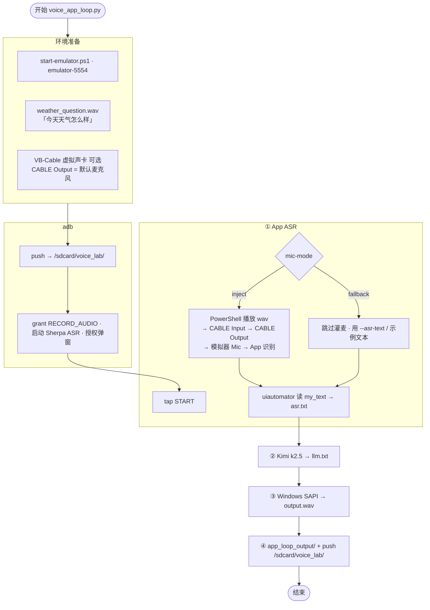

# 模拟器 App 语音环回 — 流程图

## 左 / 右 是什么？

| 位置 | 是什么 | 做什么 |
|------|--------|--------|
| **← 左边** | **Windows 宿主机** | 跑 `voice_app_loop.py`、PowerShell 播放 wav、VB-Cable 虚拟麦克风、Kimi 调完后的 SAPI 合成、`app_loop_output/` 输出 |
| **→ 右边** | **Android 模拟器** | `emulator-5554`、Sherpa ASR App 录音识别、UI 显示文字、`/sdcard/voice_lab/` 存 wav |
| **中间** | **云端 Kimi** | 把识别文字发出去，大模型回复回到宿主机 |

**数据怎么走：**

1. **左 → 右**：播放 wav，经虚拟 Mic 进 App  
2. **右 → 左**：从 App UI 读出 `asr.txt`  
3. **云端 → 左**：Kimi 返回 `llm.txt`，宿主机合成 `output.wav`  
4. **左 → 右**：`adb push` 把回复 wav 推回模拟器  

打开 **`voice_flow.html`** 看带颜色标注的图（蓝=左，绿=右，黄=云端）。

---

## 打开方式（推荐）

**双击用浏览器打开（一张完整流程图）：**

```
android-emulator/voice_flow.html
```

完整路径：

```
D:\pythonProj\MyGUITest\TestAppGUI\testApp\android-emulator\voice_flow.html
```

---

## 一张总流程图（Markdown 预览）

若 IDE 支持 Mermaid，下面即完整单图；否则请用上面的 `voice_flow.html`。



---

## 命令

```powershell
cd d:\pythonProj\MyGUITest\TestAppGUI\testApp\android-emulator
python voice_app_loop.py -i audio_samples/weather_question.wav
python voice_app_loop.py -i audio_samples/weather_question.wav --mic-mode fallback
.\scripts\setup_virtual_mic.ps1
```
